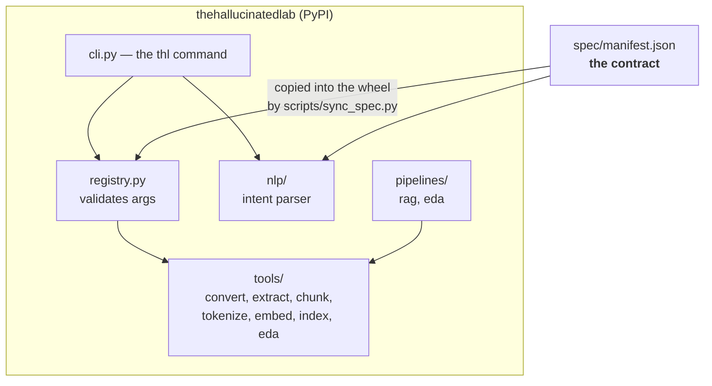

# Architecture

> Standing constraints live in [STANDARDS.md](STANDARDS.md). This file
> explains the decisions those constraints came out of.

The short version: **a pip package, a `thl` command, and one spec file they
both read.**

Everything below follows from a constraint that was chosen deliberately and
is worth keeping:

**Nothing leaves the machine.** No telemetry, no third-party origins, no
backend we operate, no account. A tool runs in your process and writes to
your disk.

## The pieces

## Why the spec is a file and not code

`spec/manifest.json` defines every tool, its arguments, their types, bounds
and defaults. Three consumers read it:

- `cli.py` renders `thl tool` from it
- `nlp/` uses it to fill slots from a sentence
- `registry.py` validates the Python API against a copy baked into the wheel

The alternative was restating the bounds in each place. That works right up
until quality caps at 100 in one and 95 in another, and the help text
documents an argument the package rejects. `scripts/sync_spec.py --check`
fails CI if the wheel's copy has drifted, and `python/tests/test_registry.py`
asserts the same thing from the other side.

**This is the single most important structural decision in the repo.**
If you change one thing, change it in the manifest.

## Why the base install is small

`pip install thehallucinatedlab` is Pillow and nothing else. Everything
heavier — pandas, torch, chromadb, the document parsers — is an extra, and
every tool imports its dependency *inside the function that needs it*
(see `deps.py`). That keeps the extras genuinely optional rather than
optional in the metadata and mandatory at import time.

The payoff is that someone who came for `convert` does not pay for an
embedding model they will never load. The cost is that a missing extra is a
runtime error rather than an install-time one, so the error has to be good:
`DependencyMissing` names the exact `pip install` line, and `cli.py` offers
to run it when there is a tty to ask.

## Why the CLI has two namespaces

`thl tool <name>` runs one thing. `thl pipeline <name>` runs a chain of
them. Keeping them apart is the only way `thl tool extract` and
`thl pipeline rag` can both be true statements about the same code, where
the pipeline is visibly made of the tools rather than a parallel
implementation of them.

Bare `thl tool` and `thl pipeline` list what exists, so there is no separate
listing command to remember and nothing that can fall out of sync with the
real set.

## Why the parser is rules and not a model

Turning "make it a jpg at 80 quality" into a call is intent classification
plus slot filling: bounded, solved, and far better served by rules that run
instantly and can be tested than by weights that cannot. `nlp/` scores
candidate tools from the manifest's own vocabulary, which is why adding a
tool teaches the parser about it without touching the parser.

The parser reports what was *said*. Bounds are enforced afterwards by the
registry, so there is one place that decides whether `quality=900` is legal.

## Where state lives

| State | Lives in | Bounded by |
|---|---|---|
| Tool output | Beside the input, or the path you give | You choose |
| Pipeline artefacts | A directory per run (`report.rag/`, `sales.eda/`) | One directory, named after the input |
| Tool spec | `spec/manifest.json`, copied into the wheel | One file |

There is no server-side state because there is no server. A pipeline writes
each stage's artefact before the next one runs, so a partial run is
inspectable and resumable rather than lost.

## What used to be here

This repository was once a static site — hand-written HTML and browser
JavaScript that ran the same tools in a tab — with the Python package
underneath it, sharing `spec/manifest.json` between the two.

The site has been removed. The browser implementations of each tool, the
site's ~9,400 lines of JavaScript, its page chrome, its tests and its
deployment are gone; the package is what remains. Two things went with it
because they existed only to serve a page:

- **`thl serve`**, a loopback HTTP bridge that let a page on the site hand a
  document to a local install. With no page to call it, it was a bridge to
  nowhere.
- **The `page` field in each manifest tool entry**, which named the doc page
  that covered the tool. There are no doc pages; `thl tool <name>` is the
  reference now.

`spec/` stayed, and that is worth knowing: it looks like site furniture but
`python/tests/conftest.py` loads the fixtures from it, so deleting it would
have taken the test suite with it.
